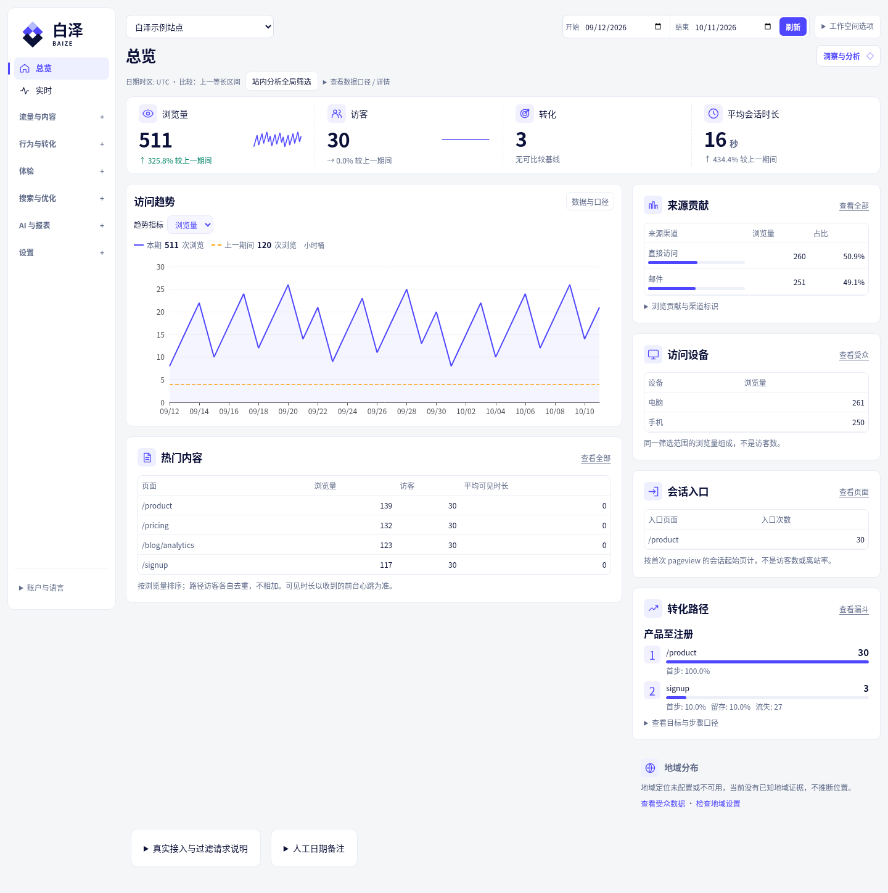
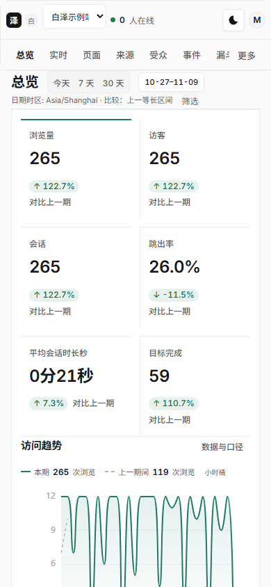

# Baize Analytics

**Understand traffic, page performance and conversions on your own server.**

Baize is free, self-hosted, privacy-oriented website analytics with Chinese and English interfaces. Add a tracker snippet to your website to see traffic, acquisition channels, pages and audiences, then enable events, goals, SEO or AI assistance as needed. There are no paid product feature gates; you cover your own hosting and external-service costs.

[中文](README.md) · [Documentation index](docs/README.md) · [Node deployment](docs/deployment-methods.md) · [PHP installation](docs/PHP_INSTALLATION.md) · [English documentation](docs/en/README.md) · [API](docs/en/api.md)

## What you can do

- **Understand traffic and content:** pageviews, visitors, sessions, channels, UTM, pages, devices, geography and Web Vitals, with date ranges and filters. Standard also provides live traffic views.
- **Measure business actions:** custom events and goals; Standard adds funnels, retention, paths and experiment attribution.
- **Manage websites and data:** site permissions, accounts, exports, data retention and visitor deletion. Standard adds team invitations, sharing, scheduled reports and alerts.
- **Investigate when needed:** Standard includes opt-in masked replay, heatmaps and external search/AI connectors. Lite offers manual pasted-HTML SEO checks and manual BYOK AI.
- **Keep privacy controls:** raw IP handling stays in ingestion memory; consent controls and a separately durable deletion journal support deletion and recovery without reviving removed data.

## Interface

The desktop overview groups period comparisons, trends, sources, popular pages and session entry pages. Locations, devices and goal completions share one reading area. Mobile displays all six core metrics without clipped numbers.

Screenshots use synthetic data.



<details>
<summary>Mobile layout</summary>



</details>

## Choose an installation runtime

| Runtime | Installation guide | Database and scope |
| --- | --- | --- |
| Original Node application | [Docker and precompiled packages](docs/deployment-methods.md), [Node hosting in 1Panel/Baota](docs/PANEL_INSTALLATION.md) | The PostgreSQL Standard application and existing SQLite Lite profile remain available |
| Independent PHP application | [PHP + database web installation](docs/PHP_INSTALLATION.md) | Separate `php/` implementation for PHP-FPM, MySQL and 1Panel; see its guide for implementation coverage and actual validation |

The PHP application targets the Standard feature scope and is maintained separately from Node Lite; [tested coverage and runtime differences](docs/PHP_PARITY_MATRIX_20261015.md) are documented explicitly. Use its own installer, database migrations and maintenance commands. The original Node application, SDK, migrations and tests remain in the repository.

## Original Node application: Standard or Lite?

Both Node profiles share the brand, interface and tracker. Available features follow the server's capabilities.

| | Standard | Lite |
| --- | --- | --- |
| Storage | PostgreSQL; optional Redis and advanced ClickHouse storage modes | Local SQLite |
| Processes | Standard features and independent workers; scaled deployments require their applicable operating contracts | One application process and one local writer; no multiple instances or network filesystems |
| Analytics | Traffic, pages, sources, audience, events, Vitals and goals | Traffic, pages, sources, audience, events, Vitals and simple event goals |
| Advanced analysis | Funnels, paths, retention, replay, heatmaps and experiments | These capabilities are unavailable |
| SEO / AI | Opt-in search, SEO and AI connectors | Manual HTML audit; manual OpenAI BYOK with explicit permission to send data and request/input/output limits |
| Maintenance | PostgreSQL backups and deletion-journal recovery; native maintenance is PG-only | Consistent SQLite backups and deletion-journal recovery; offline migration into an empty Standard target |

Choose Lite for a single instance with fewer database services to maintain. Choose Standard for deeper behavioral analysis or its connectors. Changing an image or connection string does not convert profiles; follow the [Lite migration procedure](docs/lite-migration.md).

## Three deployment paths for Node

| Path | Requirements | Use it when |
| --- | --- | --- |
| Docker installer | Docker Engine, Compose v2, Bash and full source; Standard Compose supplies PG/Redis | You manage applications and persistent volumes with Docker |
| Node-ready package | Linux x64, a supported Node 24 runtime, Bash/flock; Standard also needs PostgreSQL | You already have Node hosting or a process-management panel |
| bundled-node package | Compatible Linux x64/glibc, Bash/flock; Standard also needs PostgreSQL | You want the supplied Node binary without installing dependencies or compiling |

Runtime packages already include dependencies and compiled assets. Do not run `npm install` or `npm run build` on them. Bundled Node does not include database servers, TLS or a process manager. These native packages do not support Windows, macOS, ARM or Alpine.
Local development on Windows (Lite runs natively): see [docs/WINDOWS-LOCAL-DEV.md](docs/WINDOWS-LOCAL-DEV.md).

### Docker

From the source directory, choose one profile:

```bash
bash install.sh       # Standard
# or
bash install-lite.sh  # Lite
```

The installer preserves existing configuration and data and listens locally at `http://localhost:3000`. It tells you the location of a private one-time installation credential file without printing the credential. Existing installations use normal sign-in.

### Precompiled packages

Verify the delivered SHA256 and extract the chosen profile into a separate release directory with `tar --same-permissions -xzf package.tar.gz`. Keep data, keys and configuration outside the release. The service user must own private mode-0700 data/key directories and the mode-0600 environment file. Standard requires `DATABASE_URL`; maintenance also needs matching PostgreSQL client tools.

From the extracted package root:

```bash
bash scripts/release-start.sh --env-file /absolute/private/runtime.env
```

For long-running service, use the operator-reviewed [systemd example](deploy/baize.service.example), [Supervisor example](deploy/baize.supervisor.conf.example) or your panel's process manager. Node panels can use the package's `npm start` or `dist/server/src/release/panel-start.js`; disable automatic dependency installation and builds. Process supervision must continue independently of terminals and browsers.

See [deployment and first use](docs/deployment-methods.md) for configuration, permissions and application-image save commands, and [package contents](docs/release-packages.md) for runtime requirements. An application image save excludes PG/Redis/CH. Source archives, dist-only archives and Git bundles are not complete runtime packages.

## Connect your first website

1. Open Baize, enter the one-time credential from the private local file and create the administrator. Never put the credential in a URL, chat or log; remove the local copy after setup.
2. Create a site with its domain, timezone and privacy settings.
3. Copy the site's tracker snippet into the website's `<head>`. Your Baize service supplies the tracker. Configure HTTPS and the correct `PUBLIC_URL` before external use.
4. Visit the website, check ingestion status, then open Overview and Pages. If consent is required, accept it before collecting.

An empty dashboard or a copied snippet does not prove successful ingestion. Check the site domain, script URL, browser network requests, consent state and ingestion status when data is missing.

## Backups, upgrades and private data

- Keep data, keys, configuration and backups in private persistent directories or volumes, never in a public web root. Lost versioned keys make saved connector secrets unreadable.
- Protect the database, independent deletion journal and watermark, associated files and separate key package together. A database-file copy alone is not a valid backup; never copy a live SQLite main file as a Lite backup.
- Stop writes and preserve a recovery point before upgrading. Native upgrades validate a candidate in a new database/directory; the operator explicitly switches the service afterward. Failure preserves the source. Rollback requires a compatible old-version recovery point and the latest deletion journal, not just the old image tag.
- Recovery revokes old sessions and temporary authorizations; users sign in again. Native Standard maintenance refuses strict ClickHouse-authority mode.

Procedures: [native Standard maintenance](docs/release-native-ops.md), [Docker and HTTPS](docs/en/deployment.md), [Lite maintenance](docs/lite-deployment.md), [migration and recovery](docs/en/migration.md).

## FAQ

**Do I need a cloud account?** Core analytics does not. Standard needs PostgreSQL; Lite uses local SQLite. GeoIP, search, email, SSO and AI services are configured only when needed.

**Does core analytics automatically send data to AI?** No. AI stays off until an administrator configures BYOK with their own key. Data is sent only when you allow that call.

**Can I use my domain or a Node hosting panel?** Follow the Node entrypoint and reverse-proxy instructions. `PUBLIC_URL` does not issue a certificate or open the port.

**Why is a metric unavailable?** Daily-salt mode has no cross-day distinct visitors, identify, or retention. Missing data stays blank.

**What can cost money?** Your server, plus model and SERP APIs if you turn them on. Baize has no paid feature gates.

## Documentation and licenses

[Documentation index](docs/README.md) · [Historical documents and path map](docs/archive/README.md) · [English guides](docs/en/README.md) · [API](docs/en/api.md) · [Development](docs/en/development.md) · [Compatibility](docs/en/compatibility.md) · [Implementation and acceptance boundaries](docs/STATUS.md) · [Feature checklist and historical evidence](docs/IMPLEMENTATION_CHECKLIST.md)

Application: **AGPL-3.0-only**. Independent website tracker: **MIT**. Embedding the tracker has different license obligations from modifying or hosting the application. See [LICENSE](LICENSE) and [tracker LICENSE](packages/tracker/LICENSE).
