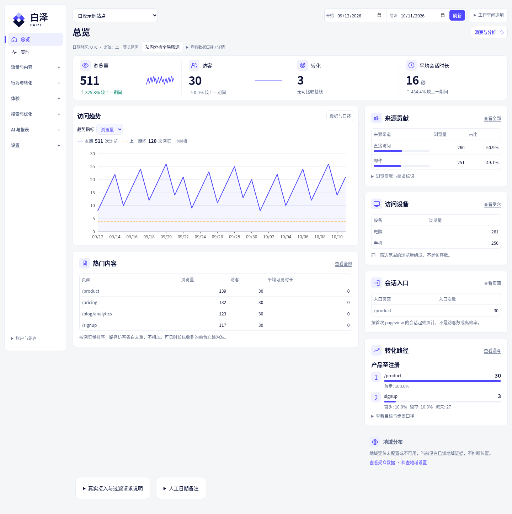
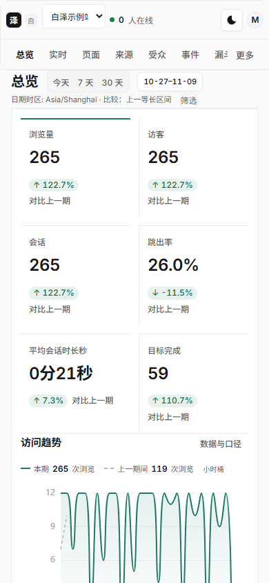

# 白泽 Baize Analytics

**把网站流量、页面表现和转化放在自己的服务器上。**

白泽是免费、自托管、隐私优先的网站分析平台，提供中文与英文界面。部署后为网站添加一段追踪代码，即可查看访问趋势、来源渠道、页面和受众，并按需要启用事件分析、转化目标、SEO 或 AI 辅助分析。产品没有付费功能门槛；外部服务的费用由使用者自行承担。

[English](README.en.md) · [部署与首次使用](docs/deployment-methods.md) · [API 手册](docs/api.md) · [备份与迁移](docs/migration.md)

## 你可以用它做什么

- **查看流量与页面表现**：访问量、访客、会话、来源渠道、UTM、页面、设备与地域；按日期和条件筛选，查看 Web Vitals；标准版还提供实时访问视图。
- **追踪业务行为**：自定义事件和目标；标准版还提供漏斗、留存、路径与实验归因。
- **管理多个网站**：站点权限、账号、导出和数据保留；标准版还提供团队邀请、分享、定时报表与告警。
- **按需深入分析**：标准版可启用隐私遮罩的会话回放、热力图和外部搜索/AI 连接器；Lite 提供手动粘贴 HTML 的基础 SEO 检查与手动 BYOK AI。
- **控制数据与隐私**：原始 IP 在采集入口内存处理，提供同意控制、访客删除和独立删除日志。备份恢复会重放最新删除记录，避免旧数据复活。

## 界面

桌面概览把期间对比、访问趋势、来源、热门内容和会话入口分组排列，地域、设备与目标完成放在同一阅读区域。手机完整显示六项核心指标，不必横滑查看被截断的数字。

以下是运行中的界面，使用合成演示数据；地域也是示例位置，不代表真实业务流量或 IP 定位结果。



<details>
<summary>查看手机布局</summary>



</details>

## 选择标准版还是 Lite

两个版本共用品牌、界面和追踪脚本，按实际能力显示功能。

| | 标准版 | Lite |
| --- | --- | --- |
| 存储 | PostgreSQL；Redis 可选，ClickHouse 为可选高级存储模式 | 本地 SQLite |
| 运行方式 | 支持完整标准功能与独立 worker；扩展部署需遵守对应运行合同 | 一个应用进程、一个本地数据库写入者；不支持多实例或网络文件系统 |
| 核心统计 | 流量、页面、来源、受众、事件、Vitals、目标 | 流量、页面、来源、受众、事件、Vitals、简单事件目标 |
| 深度分析 | 漏斗、路径、留存、回放、热力图及实验等 | 不提供这些高级能力 |
| SEO / AI | 按需配置搜索、SEO 与 AI 连接器 | 手动 HTML 检查；仅手动 OpenAI BYOK，显式允许外发，有请求次数和输入/输出限制 |
| 运维 | PG 备份与删除日志恢复；原生维护工具仅支持 PG-only | SQLite 一致性备份、删除日志恢复；可离线迁移至标准版空目标 |

Lite 适合希望少维护数据库服务的单实例部署。需要深度行为分析或标准连接器时选择标准版。两者不能通过换镜像或改连接串互相转换；迁移步骤见 [Lite → 标准版](docs/lite-migration.md)。

## 三种部署方式

| 入口 | 需要准备 | 适用情况 |
| --- | --- | --- |
| Docker 一键安装 | Docker Engine、Compose v2、Bash、完整源码；标准版 Compose 提供 PG/Redis | 使用 Docker 管理应用与持久卷 |
| Node-ready 预编译项目包 | Linux x64、受支持的 Node 24、Bash/flock；标准版另需 PostgreSQL | 已有 Node 服务或面板托管环境 |
| bundled-node 解压启动包 | 相容的 Linux x64/glibc、Bash/flock；标准版另需 PostgreSQL | 希望使用包内 Node，不在服务器安装依赖或编译 |

运行包已经包含编译产物和依赖，不需要 `npm install` 或 `npm run build`。附带 Node 不等于附带数据库、HTTPS 或进程管理器。Windows、macOS、ARM 和 Alpine 不属于这些原生包的支持范围。

### Docker

在源码目录选择一个版本：

```bash
bash install.sh       # 标准版
# 或
bash install-lite.sh  # Lite
```

安装器保留已有配置和数据，默认只监听本机 `http://localhost:3000`。安装提示会给出私有的一次性凭证文件位置，不会打印凭证。已有安装直接登录。

### 预编译运行包

核对交付 SHA256，将对应 profile 的包解压到独立发布目录，使用 `tar --same-permissions -xzf 包文件.tar.gz` 保留清单权限。数据、密钥和配置放在发布目录之外：数据/密钥目录由运行用户拥有，权限 0700；环境文件为 0600。标准版配置外部 `DATABASE_URL`，维护时还需匹配的 PostgreSQL 客户端工具。

在解压后的包根目录运行：

```bash
bash scripts/release-start.sh --env-file /绝对路径/私有配置.env
```

长期运行使用 [systemd 示例](deploy/baize.service.example) 或既有面板的进程管理器。Node 面板可使用包内 `npm start` 或 `dist/server/src/release/panel-start.js`；关闭自动安装依赖和自动构建。进程托管应独立于终端和浏览器。

完整配置、镜像 save 启动、依赖与权限步骤见 [部署指南](docs/deployment-methods.md)；运行包清单见 [发布包说明](docs/release-packages.md)。应用镜像 save 不包含 PG/Redis/CH，源码包、只有 dist 的压缩包和 Git bundle 也不是完整运行包。

## 第一次接入网站

1. 打开白泽，在初始化页面填写私有文件中的一次性凭证，创建管理员。凭证不要放入网址、聊天或日志，完成后删除本地副本。
2. 创建站点，填写网站域名、时区，并选择适合的隐私设置。
3. 复制站点提供的追踪代码，添加到网站的 `<head>`。追踪脚本由你的白泽服务提供；对外使用前配置 HTTPS 和正确的 `PUBLIC_URL`。
4. 访问网站产生一次真实浏览，查看采集状态，再查看总览和页面报表。启用同意要求时，先完成同意操作。

不要用空看板判断接入成功，也不要把“脚本已复制”当作采集已完成。无数据时先检查站点域名、脚本地址、浏览器网络请求、同意状态和采集状态。

## 备份、升级与数据保护

- 将数据、密钥、环境配置和备份保存在私有持久目录或卷中，不放入公开网站根目录。版本密钥丢失会使已保存的连接器秘密无法解密。
- 备份同时保护数据库、独立删除日志及水位、关联文件和独立密钥包；仅复制数据库文件不等于有效备份。Lite 不能直接复制正在写入的 SQLite 主文件。
- 升级前停止写入并保全恢复点。原生升级在新的数据库/目录验证候选版本，之后由运营者明确切换服务；失败保留源数据。回滚需要兼容旧版本的恢复点和最新删除日志，不能只换回旧镜像。
- 恢复会撤销旧会话和临时授权，用户重新登录。原生标准版维护不支持严格 ClickHouse 权威模式，相关操作会提前拒绝。

命令与前置条件：[标准版原生维护](docs/release-native-ops.md)、[Docker 与 HTTPS](docs/deployment.md)、[Lite 维护](docs/lite-deployment.md)、[迁移与恢复](docs/migration.md)。

## 常见问题

**需要注册云服务吗？** 核心统计不需要。标准版需要 PostgreSQL；Lite 使用本地 SQLite。GeoIP、搜索、邮件、SSO 和 AI 等外部功能按需配置。

**不用 AI，会发送数据给模型服务吗？** 不会因核心统计自动启用 AI。BYOK 需要管理员配置；它表示使用自己的服务密钥，不表示本地推理。Lite 每次手动调用还需明确允许外发。外部模型输出是辅助建议，不保证事实或效果。

**能用自己的域名或宝塔吗？** 可以按 Node 托管入口和反向代理指南配置。`PUBLIC_URL` 不会自动签发证书或开放公网；实际域名、证书和面板环境需由部署者确认。

**为什么某些指标不可用？** 不同 profile、隐私模式、保留范围和数据覆盖有不同边界。每日盐模式不支持跨日访客去重、identify 或留存；不能证明完整的数据会显示不可用，而不是补零或伪造精度。

**免费是否有功能收费门槛？** 没有。服务器、外部模型、SERP 等服务仍可能产生费用，白泽不会替你购买或创建生产账号。

## 文档与许可证

[用户 API](docs/api.md) · [英文文档](docs/en/README.md) · [开发指南](docs/development.md) · [兼容性](docs/compatibility.md) · [项目状态与验收边界](docs/STATUS.md) · [逐项实现与历史证据](docs/IMPLEMENTATION_CHECKLIST.md)

本轮性能优化及实际复验范围见 [性能复验记录](docs/PERFORMANCE_OPTIMIZATION_20261013.md)。历史运行包仍对应各自的固定版本；新源码不能替换旧包的版本标识。

应用主体采用 **AGPL-3.0-only**；独立网站追踪脚本采用 **MIT**。嵌入 tracker 与修改、托管应用主体的许可责任不同，详见 [LICENSE](LICENSE) 与 [tracker LICENSE](packages/tracker/LICENSE)。

实例拥有者可在“设置 → 系统更新”核对增量版本与下载量。首次接入、支持范围和回滚规则见 [实例增量更新指南](docs/INSTANCE_INCREMENTAL_UPDATES.md)。

维护执行器失去独占锁时保持维护状态，确认旧执行器及任务停止后再接续。部署交付为标准/Lite两个离线Docker包与四个原生包，源码和执行器是额外附件；详见实例增量更新指南。
