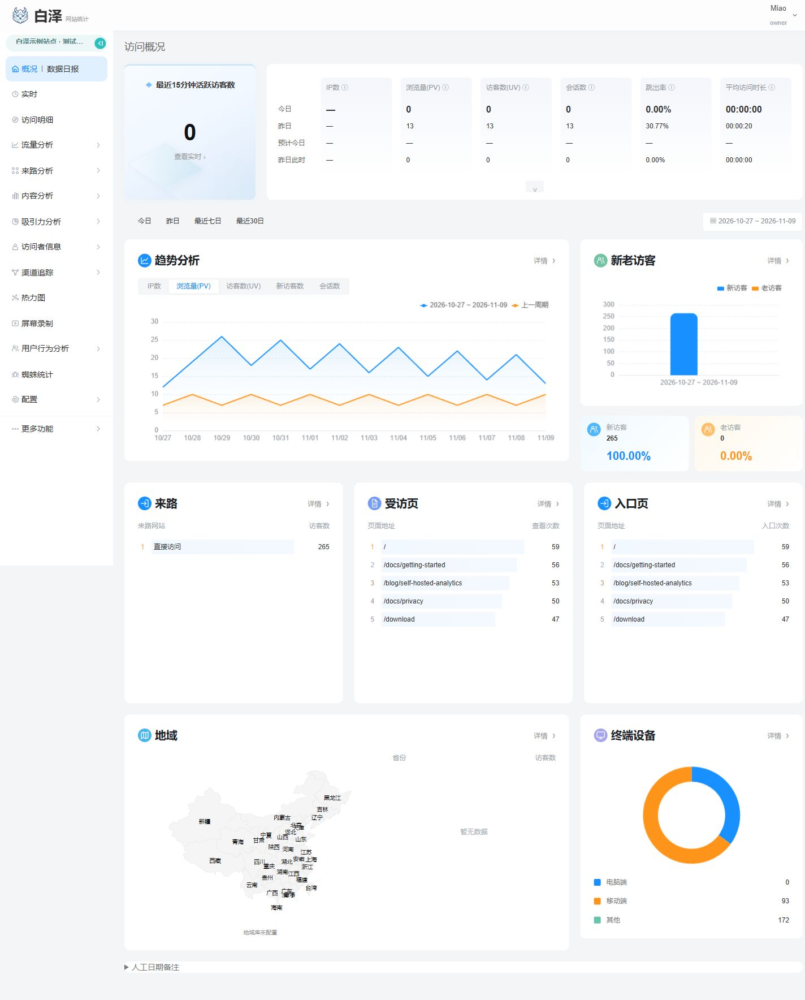
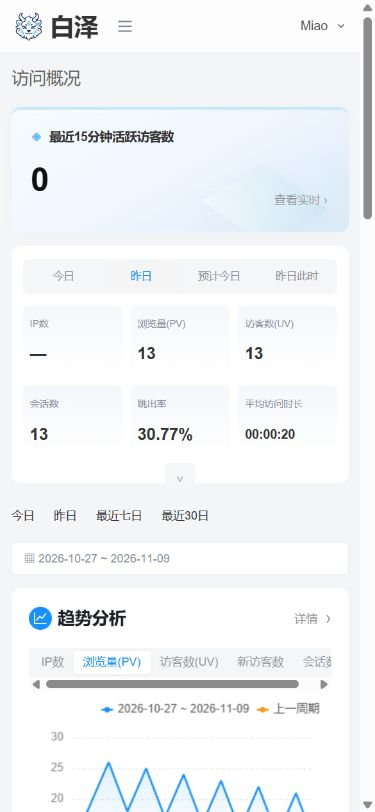

<p></p>

# 白泽 Baize Analytics

**把网站流量、页面表现和转化放在自己的服务器上。**

白泽是一套免费、自托管的网站分析工具，提供中文和英文界面。接入追踪代码后，可以查看访问、来源、页面与受众，再按需要启用事件、目标、SEO 和 AI 分析。功能不设付费门槛，服务器和外部服务的费用由使用者承担。

项目正在打磨完善，欢迎通过 [Issue](https://github.com/bocmiao/baize-analytics/issues) 反馈问题，也欢迎提交 [PR](https://github.com/bocmiao/baize-analytics/pulls)。

[English](README.en.md) · [安装指南](docs/deployment-methods.md) · [PHP 安装](docs/PHP_INSTALLATION.md) · [文档导航](docs/README.md) · [参与贡献](CONTRIBUTING.md)

## 能做什么

- **看清网站访问**：浏览量、访客、会话、来源渠道、UTM、热门页面、设备、地域和 Web Vitals，支持日期筛选与期间对比。
- **追踪事件与转化**：自定义事件和目标；标准版还提供漏斗、路径、留存与实验归因。
- **管理多个站点**：站点权限、数据导出、保留期限和访客删除；标准版支持团队邀请、分享、定时报表与告警。
- **按需分析**：标准版可启用会话回放、热力图、搜索连接器和 AI；Lite 提供手动 HTML 检查和手动 BYOK AI。
- **保留数据控制权**：支持采集同意、隐私设置和独立删除日志；恢复备份时重放删除记录。AI 默认关闭，使用时由你提供密钥并授权外发。

## 界面预览

当前后台采用白色桌面工作台，手机端提供适配的导航与报表布局。预览使用独立演示站点的数据；[截图来源与验证范围](docs/images/README.md)。

这版新增的流量报表由 **Node 标准版**提供；Node Lite 和独立 PHP 版保留各自既有能力。具体范围见[界面与报表说明](docs/51LA_ALIGNMENT.md)。



<details>
<summary>查看手机布局</summary>



</details>

## 选择运行方式

| 运行方式 | 存储与部署 | 适用范围 |
| --- | --- | --- |
| **Node 标准版** | PostgreSQL；Docker 安装提供 PostgreSQL 和 Redis，也可独立托管 | 完整统计、行为分析、团队协作与连接器 |
| **Node Lite** | 本地 SQLite，单应用进程；不需要独立数据库服务 | 核心统计、事件、简单事件目标，以及手动 SEO / AI |
| **独立 PHP 版** | PHP 8.3+、PHP-FPM、MySQL 和 CLI worker | 面向 PHP / 1Panel 环境，功能对照和数据库兼容性见 [PHP 指南](docs/PHP_INSTALLATION.md) |

Lite 不提供漏斗、路径、留存、回放、热力图等高级能力，只支持一个本地数据库写入者，不使用网络文件系统。需要转到 Node 标准版时，按 [迁移指南](docs/lite-migration.md) 操作。

PHP 使用独立的安装器、数据表和维护命令；已有 Node 数据不能直接换成 MySQL。Node 标准版的 Redis、ClickHouse 扩展配置见 [部署文档](docs/deployment.md)。

## 快速安装：Docker

准备好 **Docker Engine、Compose v2、Git 和 Bash**。以下命令会从源码构建镜像：

```bash
git clone https://github.com/bocmiao/baize-analytics.git
cd baize-analytics

# 选择一种运行方式
bash install.sh       # Node 标准版
# bash install-lite.sh  # Node Lite
```

默认访问地址为 `http://localhost:3000`，仅监听安装机器的本地接口。安装完成后，终端会提示私有凭证文件 `.baize/install-nonce.json` 的位置。

1. 在安装机器上读取该文件的 `nonce` 字段，填入初始化页面并创建管理员。
2. 创建站点，填写域名、时区和隐私设置。
3. 将站点提供的追踪代码加入网站 `<head>`。
4. 访问网站，核对采集状态和总览中的新访问；若启用了采集同意，先完成授权。

初始化凭证仅供站长使用，完成后删除本地副本。已有安装使用原账号登录。

在 NAS、其他电脑或公网访问时，需要按 [网络与反向代理说明](docs/deployment.md) 设置监听地址、`PUBLIC_URL` 和受信代理；公网使用 HTTPS。数据库、密钥和备份放在私有持久目录或卷中。

其他安装入口：

- **NAS 固态硬盘测试部署**：[SSD 目录、独立 Compose 与采集验证](docs/NAS_TESTING.md)。
- **1Panel / 宝塔 Node 托管**：[安装与网页初始化](docs/PANEL_INSTALLATION.md)。
- **预编译 Node 运行包**：[部署方式](docs/deployment-methods.md) 与 [包内容说明](docs/release-packages.md)。按包内清单核对版本、平台和 SHA256。
- **PHP / MySQL**：[PHP 安装指南](docs/PHP_INSTALLATION.md)。源码构建包与接收服务器的安装步骤分别说明。

## 常用文档

| 要做什么 | 文档 |
| --- | --- |
| 接入 API、WordPress 或小程序 | [API 手册](docs/api.md) · [WordPress 插件](plugins/wordpress/README.md) · [Tracker 与 SDK](packages/tracker/README.md) |
| 配置隐私与数据保留 | [隐私说明（英文）](docs/en/privacy.md) |
| 备份、恢复、升级与迁移 | [维护与迁移](docs/migration.md) · [Lite 维护](docs/lite-deployment.md) · [实例增量更新](docs/INSTANCE_INCREMENTAL_UPDATES.md) |
| 开发与测试 | [开发指南](docs/development.md) · [贡献说明](CONTRIBUTING.md) |
| 核对功能范围与历史验证 | [功能清单](docs/IMPLEMENTATION_CHECKLIST.md) · [版本状态与验收记录](docs/STATUS.md) |

完整入口见 [文档导航](docs/README.md)。历史验收和运行包都对应各自的源码版本，部署时以所用版本的清单与说明为准。本次文件整理与历史附件位置见 [仓库维护记录](docs/REPOSITORY_MAINTENANCE_20261110.md)。

## 参与贡献

欢迎报告安装问题、修正文档、改进界面和提交功能修复。Issue 请附上运行方式、版本、复现步骤与去掉敏感信息的日志；PR 请说明改动和实际执行的检查。

本地开发使用 Node.js 24，依赖由 `package-lock.json` 锁定。常用检查为 `npm run lint`、`npm run typecheck`、`npm run test:unit` 和 `npm run build`；数据库集成与浏览器测试的环境要求见 [开发指南](docs/development.md)。

## 许可证

应用主体采用 **AGPL-3.0-only**，独立网站追踪脚本采用 **MIT**。嵌入 tracker 与修改、托管应用主体的许可责任不同，详见 [LICENSE](LICENSE) 和 [tracker LICENSE](packages/tracker/LICENSE)。
