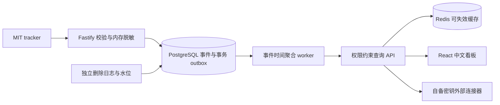

# 白泽 Baize Analytics

永久免费、自托管、隐私优先的中文网站分析平台。TypeScript / Fastify / React + Vite / PostgreSQL / Redis。所有功能免费，外部 AI、SERP 等服务成本由部署者承担。

当前为私有仓库中的开发版本；实现与验收以 docs/IMPLEMENTATION_CHECKLIST.md、实际测试记录为准。设计规格不代表已完成。不开源发布、不自动外网部署。

## 本地运行

安装 Docker 与 Compose v2，在已有私有 checkout 执行 `./install.sh`。默认监听 http://localhost:3000，首次访问创建管理员、站点并获取 tracker。密钥自动生成；重复安装保留本地数据和配置。当前镜像本地构建，不发布注册表。

用户接口与权限/范围/错误见 [API 手册](docs/api.md)，前向迁移、独立最新删除日志、备份文件/密钥和恢复升级见 [迁移运行手册](docs/migration.md)。开发与验证见 [development](docs/development.md)，部署与反代见 [deployment](docs/deployment.md)，兼容性见 [compatibility](docs/compatibility.md)，完整英文用户入口见 [docs/en](docs/en/README.md)。规格 [PROJECT_SPEC](docs/PROJECT_SPEC.md) 是目标，当前完成/在制/外部未实测以 [清单](docs/IMPLEMENTATION_CHECKLIST.md) 为准。

## 数据流与开发验收

| 范围 | 当前验收边界 |
|---|---|
| 采集、会话、漏斗、留存、Vitals | 有真实 PostgreSQL 与浏览器测试，逐项见 [清单](docs/IMPLEMENTATION_CHECKLIST.md) |
| 权限、分享、导出、删除、定时报表 | 有真实 API/数据库/文件测试，见 [治理验收](docs/ACCEPTANCE_GOVERNANCE.md) |
| GSC、GA4、SERP、BYOK AI、企业微信 | 安全连接器与模拟集成不代表真实外部账号已实测 |
| 安装、备份、新卷恢复、升级回滚 | 本地 Docker 验收记录见 [运维验证](docs/validation-ops.md) |
| P2 与规模化 | 部分实现；ClickHouse 完整迁移与完整多语言等剩余项见逐项清单 |

[看板截图](docs/screenshots/dashboard-acceptance.png) 来自验收测试写入的真实数据库事件，仅说明测试结果，不代表生产流量。

标准模式支持跨日访客分析；每日盐模式不支持 identify、跨日 UV 去重或留存。原始 IP 仅在入口内存处理。删除先保存独立日志再提交，恢复必须验证最新日志及水位；请将日志与版本密钥分别保存在受保护的持久卷。

主体 **AGPL-3.0-only**，独立 tracker **MIT**。无收费功能门槛。第三方依赖许可证按 lockfile 核查；未完成正式发行级 SBOM 审计前不声称审计完成。
