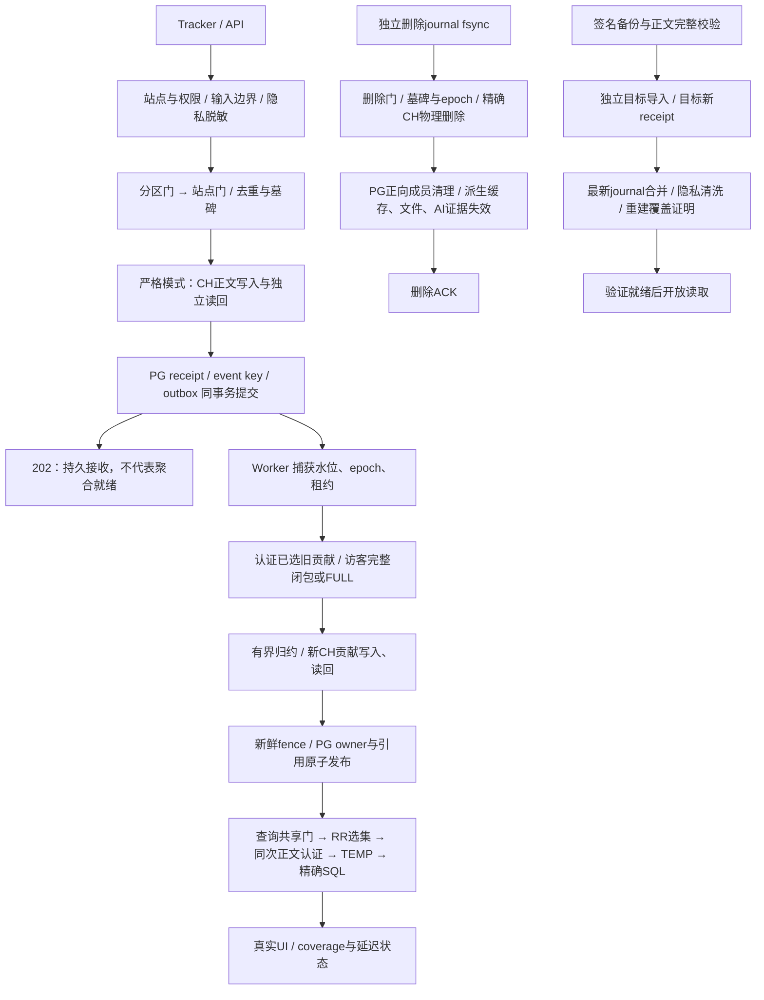

# 白泽链路与结构审查

日期：2026-10-12 UTC。审查基线：`7634a16c4e75d1e53910f799624906b1da1158a0`；应用代码与原合同5000对照 `42d1b8e` 相同。先完成冻结验收，再开展本次有限审查，未替换协议或继续压测。

## 已验证范围

冻结本地 regular EXIT0：434单元、564真实PG/CH/Redis集成、31 E2E目录（29实际Chromium、2日期函数），0失败/跳过。包括独立签名恢复、最新删除日志删A保B。清单复用显式1，默认仍0。[完整原始结果](performance/fact-validation-manifest/full-7634a16-pass/outcome.json)。新镜像和该镜像独立恢复因5GiB磁盘预留不足未运行，不能借历史72镜像结果补齐。

原合同5000候选一次PASS与全套是不同证据：[两个plan/result/哈希](performance/fact-validation-manifest/formal5000/comparison.json)。关闭4950/1未发FAIL，开启5000/0未发PASS。队列、速度、排空、ACK合同未改；候选实际采集118.076秒，总墙钟243.407秒，未证明生产持续容量。旧FAIL与B隔离received协议不混合。

## 实际流程

PG默认模式直接在上述持久化事务保存原始事件；严格CH模式不能在CH不可读时回退空PG并报告完整。B durable inbox仍是默认关闭的隔离原型，不在正式202链中。

| 环节 | 当前文件证据 | 不可省略的边界 |
|---|---|---|
| 鉴权与接收 | `auth.ts:10–32`、`collect.ts:52–130` | 管理cookie与站点token隔离；站点权限、去重、墓碑和正文发布用同一持锁client；事务提交后才ACK |
| 聚合与发布 | `worker-facts.ts:67–124`、`session-facts-publication.ts`、`session-contribution-overlay.ts` | 旧认证与新发布是不同作用域；未变owner保留、退役ID空owner；来源、删除epoch、租约新鲜检查 |
| 查询 | `site-snapshot.ts:9–17`、`stats-read-snapshot.ts:15–24`、`remaining-fact-source.ts:103–110` | 先拿门后固定RR；选集、同次CH正文、清单HMAC、来源与完成标记共同证明，不靠过去合法签名判断当前性 |
| 删除 | `deletion.ts`、`identity.ts`、`fact-invalidation.ts` | 独立日志持久后协调入口/发布；权威明细精确删除，正向成员与AI/导出文件清理；重放不复活 |
| 恢复 | `scripts/canonical-ops-runtime.ts:45–53`、`fact-body-backup.ts:44–56` | 固定旧包投影验签与原逐行认证；目标新签；最新journal处理后才ready；unknown退休来源不能伪造完整性 |

## 发现与处理顺序

| 事项 | 证据等级 | 收益 / 成本 / 风险 | 建议与验证 |
|---|---|---|---|
| finally CLOSE覆盖首SQL错误 | **真实发生**：ad15105失败外层25P02；≤057真实缺060字段另证42703。`fact-closure-migration.ts:47`；备份三个cursor同型 | 直接改善定位；小改；误吞成功路径清理错误是风险 | **本批窄修**：始终尝试CLOSE，有首错保原对象/SQLSTATE，无首错清理失败仍抛。真实PG22012→25P02、ROLLBACK后复用、无首错34000及正常路径回归。不改签名、选集、事务提交 |
| 查询共享门涵盖认证、TEMP和SQL | **代码事实+既有测量**；`stats-read-snapshot.ts:15–20`。旧239 site_lock累计104.572秒/max10.690秒 | 减少持锁可能改善采集背压；协议成本高；释放后仅epoch复查挡不住CH ACK/PG回滚 | **不直接unlock**。新记录可用匿名request区间关联shared wait/hold。若另立协议，必须绑定当前PG合法attempt/选集、删除和恢复边界，故障差分通过后再讨论上线 |
| 同查询重复hydrate的猜测 | **未成立**：当前已有同client context与comparison union复用 | 没有可证收益；删除现有检查有风险 | 不改。计量真实作用域后再提出优化，不把旧源认证和新发布读回当重复工作 |
| 默认关闭时重复行schema/HMAC | **事实，但新060已有受控解决**：`fact-store.ts`及正式对照 | 小样本HTTP局部收益、原5000一次PASS；清单版本与成员校验有维护成本 | 保留显式开关、完整旧路径和坏签拒绝，不无授权默认启用。新manifest HMAC在旧authentication hook之外，不能声称未计时成本为零 |
| 清理链串行失败跳过后续release | **源码风险，未复现**：`scripts/canonical-ops-runtime.ts:53`、`history-security.ts:29–35`、`db.ts:12` | 可能改善失败后的连接回收/诊断；中等；吞恢复失败或坏连接回池危险 | 先注入第一次unlock/ROLLBACK失败，证明primary、release、destroy和失败退出行为。**本次不顺带重写**；当前仍failclosed，未据此宣称授权绕过或孤儿可见 |

## 迁移与后续边界

窄错误保留修复无数据库迁移、无数据重签、无配置切换。只对当前cursor调用接线，不修改真实历史fixture的冻结实现；校验原错误与清理失败分别可见，真实备份/恢复和发布专项复验。后续源码不同于7634a16时，专项数字单独绑定，不能把冻结全套数字挪过去。

重大读取/锁协议仅列方向，不实施架构重写。需要新协议时先ADR明确证明来源、失效条件、代际隔离、旧包迁移和可回退路径；测试含同数丢A重复B、删除/恢复旧清单回放、CH ACK后PG回滚以及原始正文已过期闭包。任何优化不得放宽原5000阈值、改变accepted语义或以hash/count替代HMAC。

当前真实资源阻塞是新镜像磁盘预留与远端Git授权传输；没有绕过、重试下载或托管CI。真实外部账户/模型/设备未测边界继续见 [唯一状态入口](STATUS.md)。本报告不增加新的无限验收门槛。

## 本次窄修实测

保留首错的helper及三个事实备份游标/闭包迁移接线已实现。真实PG复现原25P02覆盖22012，修后保22012；外层ROLLBACK后连接可用，无首错34000仍抛。完整444单元通过；27项真实发布/独立目标恢复/旧包升级/覆盖专项及1项cursor PG通过，0skip，lint/type/build通过。源文件指纹与原JSON见 [专项证据](correctness/pg-cursor-cleanup/caller-binding.json)。这些是追加窄修的实际覆盖，不把7634a16的564集成与31 E2E整轮挪给新代码；没有重压测或镜像替代。
